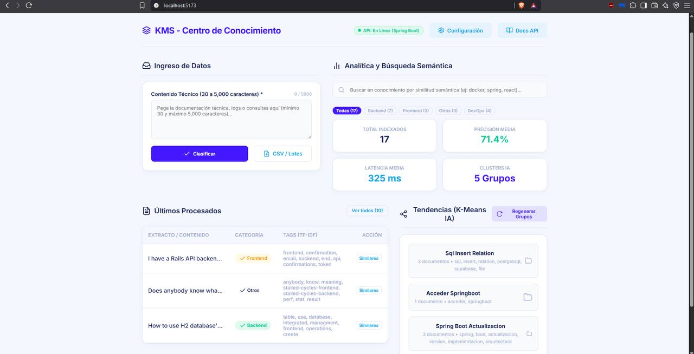

# 💻 Francoise Contreras

**`Ingeniería de Sistemas e Informática | Data & AI Engineering`**

Estudiante de Ingeniería de Sistemas e Informática, enfocado en datos e inteligencia artificial aplicada. Construyo pipelines ETL y modelos dimensionales con Python y SQL, y tableros analíticos con Power BI utilizando DAX y Excel. Desarrollo agentes de IA y arquitecturas RAG con FastAPI, LangChain y LangGraph, y automatizo flujos de punta a punta con n8n y modelado de procesos en BPMN. Trabajo con bases de datos relacionales como PostgreSQL, MySQL y SQL Server, y con MongoDB como base no relacional. Como complemento, tengo bases de desarrollo full stack con Java, Spring Boot y Angular. Uso Docker y GitHub Actions en mis proyectos, y aplico metodologías ágiles como Scrum y Kanban en equipos multidisciplinarios. Cuento con certificaciones en Google Data Analytics, AWS AI Practitioner y Oracle Cloud Infrastructure, entre otras del ecosistema TI.

  
  

## Stack Tecnológico

### AI & Data 📊

  
  
  
  
  
  
  

### Full Stack 🧩

  
  
  
  
  
  
  

### Bases de Datos & Infraestructura 🛠️

  
  
  
  
  
  
  
  

## Proyectos Destacados

<table align="center" width="100%">
  <tr>
    <!-- PROYECTO 1: INTELLIGENT INCIDENT TRIAGE -->
    <td width="50%" valign="top">
      <h4>Gestión Inteligente de Incidentes y Asistente Operacional 📊🤖</h4>
      

        Sistema inteligente para clasificación, priorización y enrutamiento automatizado de tickets e incidentes técnicos mediante modelos de NLP y APIs de inferencia.
      

      

        
        
        
        
        
        
        
      

      

        
<b>Ver captura</b>

         
        
      

      

        <a href="https://github.com/DranxFa/intelligent-incident-triage" target="_blank">Ver repositorio →</a>
      

    </td>
    <!-- PROYECTO 2: NO COUNTRY SIMULATION -->
    <td width="50%" valign="top">
      <h4>Hackaton ONE | TechMind - Plataforma Colaborativa & Microservicio ML 📚💡</h4>
      

        Desarrollo backend y microservicio de clasificación de documentación técnica para la hackaton (No Country), bajo arquitectura limpia y trabajo ágil.
      

      

        
        
        
        
        
        
        
        
        
      

      

        
<b>Ver captura</b>

         
        
      

      

        <a href="https://github.com/No-Country-simulation/G9-LATAM-Team-61" target="_blank">Ver repositorio →</a>
      

    </td>
  </tr>
  <tr>
    <!-- PROYECTO 3: ONLINE RETAIL ETL ANALYTICS -->
    <td width="50%" valign="top">
      <h4>Analítica de E-commerce: Ingeniería de Datos y BI 📊🛍️</h4>
      

        Pipeline ETL de extremo a extremo para procesamiento de datos transaccionales de retail, modelado dimensional en base de datos y dashboard analítico en Power BI.
      

      

        
        
        
        
      

      

        
<b>Ver captura</b>

         
        
      

      

        <a href="https://github.com/DranxFa/online-retail-etl-analytics" target="_blank">Ver repositorio →</a>
      

    </td>
    <!-- PROYECTO 4: CHATBOT BOOKING N8N IA -->
    <td width="50%" valign="top">
      <h4>Chatbot para Gestión de Citas - Veterinaria 🤖🐕🐈</h4>
      

        Agente conversacional en Telegram para agendamiento automatizado de citas, orquestado mediante flujos de trabajo en n8n e integración con modelos de lenguaje (LLM).
      

      

        
        
        
        
        
        
      

      

        
<b>Ver captura</b>

         
        
      

      

        <a href="https://github.com/DranxFa/chatbot-booking-n8n-ia-telegram" target="_blank">Ver repositorio →</a>
      

    </td>
  </tr>
</table>
